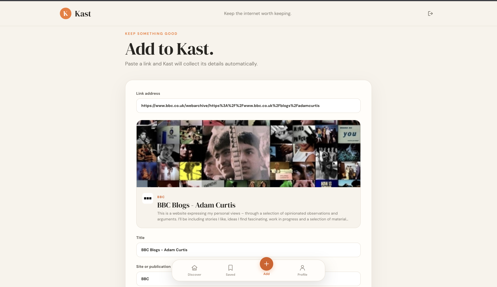

<div align="center">
  

  # Kast

  **Keep the internet worth keeping.**

  A calmer way to discover, save and share links worth revisiting.

  Built with **React**, **Node.js**, **Express** and **Firebase**.
</div>

---

## About Kast

Kast is a social bookmarking and content-discovery app built around a simple idea: the best parts of the internet are worth keeping.

Instead of an endless algorithmic feed, Kast brings together links people intentionally choose to save: articles, essays, videos, research, design inspiration and useful websites. Paste a URL and Kast automatically generates a rich preview. Add a note, choose whether to share it publicly, and return to the things you like in your personal library.

## Screenshots

### Discover — a human-curated feed

Browse links shared by the community, search by title or publication, and like interesting finds.


### Add — save a link in seconds

Paste a URL to extract the title, description, website identity and preview image. Review or edit the details before saving.



### Saved — revisit your favourites

All the links you've liked, collected in one place.


## Features

- **Automatic link previews:** extracts Open Graph, Twitter Card, HTML, JSON-LD and YouTube metadata, with fallbacks when fields are missing.
- **Discover feed:** explore public links saved by other Kast users, sorted newest first.
- **Personalised saving:** add an optional note and choose public or private visibility.
- **Search:** find posts by title, website, publication or domain.
- **Likes and saved library:** like or unlike posts; liked links appear on the Saved page.
- **Authentication:** account registration and verified-email login with Firebase Authentication and backend-issued JWTs.
- **Profile:** see your email, contributed links, liked links and feed statistics.
- **Responsive interface:** editorial typography, warm colours, mobile navigation and desktop-friendly layouts.
- **Safer metadata fetching:** backend validation of URL schemes, DNS targets, redirects, response type and download limits to reduce SSRF risks.

## Tech stack

| Layer | Technology |
| --- | --- |
| Frontend | React 19, React Router, CSS, Fetch API |
| Backend | Node.js, Express, Firebase Admin SDK |
| Authentication | Firebase Authentication, JSON Web Tokens (JWT) |
| Database | Firebase Realtime Database |
| Configuration | dotenv, CORS |

### How it works

```text
React frontend
    |
    | HTTP requests + Kast JWT
    v
Node.js / Express API
    |                \
    |                 \-- Metadata extractor --> Public websites
    v
Firebase Authentication + Realtime Database
```

The frontend communicates with the Express API rather than directly accessing Firebase. The server handles credentials, account checks, data access, likes and website metadata extraction. Firebase Admin credentials stay on the backend.

## Getting started

### Prerequisites

- **Node.js** and **npm** installed (use a current Node.js LTS release).
- A **Firebase project** with Authentication and Realtime Database enabled.
- A Firebase **service account JSON** file for the backend.
- The frontend and backend code from this repository.

### 1. Clone the repository

```bash
git clone <YOUR_REPOSITORY_URL>
cd <YOUR_REPOSITORY_FOLDER>
```

### 2. Set up Firebase

1. Open the [Firebase console](https://console.firebase.google.com/) and create or select a project.
2. Under **Build → Authentication → Sign-in method**, enable **Email/Password**.
3. Under **Build → Realtime Database**, create a database and copy its database URL.
4. Open **Project settings → General**. Under **Your apps**, register a web app if needed, and copy the project's **Web API Key**.
5. Open **Project settings → Service accounts**, generate a **new private key**, and save the downloaded JSON somewhere private on your computer.
6. Set `FIREBASE_SERVICE_ACCOUNT_PATH` to the path of that JSON file. **Never commit the JSON file or expose its contents in frontend code.**

> Firebase Realtime Database must be available to the service account configured for the API. The backend uses the Firebase Admin SDK for database operations.

### 3. Configure environment variables

The project includes example environment configuration. **Copy the example file into a `.env` file and fill in your own values**. Do not put your credentials in the example file.

For example, if the repository has separate `frontend/` and `backend/` folders, run:

```bash
# Backend
cd backend
cp .env.example .env

# Frontend (in another terminal, from the repository root)
cd frontend
cp .env.example .env
```

> **Folder-name note:** The application description does not specify the exact repository directory layout or where the example env files live. Run each command in the directory containing the corresponding `package.json` and `.env.example`. If both apps are at different paths, adjust the `cd` commands accordingly.

**Backend `.env`**

```dotenv
JWT_SECRET=replace-with-a-long-random-secret
FIREBASE_SERVICE_ACCOUNT_PATH=./secrets/firebase-service-account.json
FIREBASE_WEB_API_KEY=your-firebase-web-api-key
FIREBASE_DATABASE_URL=https://your-database-url.firebasedatabase.app
PORT=5001
FRONTEND_ORIGIN=http://localhost:3000
```

| Variable | Purpose |
| --- | --- |
| `JWT_SECRET` | Secret used to sign and verify Kast JWTs. Generate a strong, unpredictable value. |
| `FIREBASE_SERVICE_ACCOUNT_PATH` | Location of your Firebase Admin service-account JSON file, as resolved by your backend code. |
| `FIREBASE_WEB_API_KEY` | Firebase project's Web API Key, used by the backend's authentication requests. |
| `FIREBASE_DATABASE_URL` | URL of your Firebase Realtime Database instance. |
| `PORT` | Backend server port; defaults in this example to `5001`. |
| `FRONTEND_ORIGIN` | Allowed frontend origin for CORS, e.g. `http://localhost:3000`. |

To generate a JWT secret locally:

```bash
node -e "console.log(require('crypto').randomBytes(32).toString('hex'))"
```

**Frontend `.env`**

```dotenv
REACT_APP_API_URL=http://localhost:5001
PORT=3000
```

| Variable | Purpose |
| --- | --- |
| `REACT_APP_API_URL` | Base URL of your Kast backend API. |
| `PORT` | Local Create React App development-server port. |

> Create React App exposes variables prefixed with `REACT_APP_` to browser code. **Never put secrets, service-account keys or the backend `JWT_SECRET` in frontend environment variables.** Restart the dev server after changing `.env` values.

### 4. Install dependencies

From each application's directory:

```bash
# Terminal 1: backend directory
npm install

# Terminal 2: frontend directory
npm install
```

### 5. Run Kast locally

Start the backend and frontend in separate terminals, from their respective directories:

```bash
# Backend
npm start
```

```bash
# Frontend
npm start
```

Once running with the example ports:

- **Frontend:** http://localhost:3000
- **Backend:** http://localhost:5001

> The exact npm script names depend on the repository's `package.json` files. `npm start` is conventional for Create React App; if the backend uses a different script, check `scripts` in its `package.json` and use the defined command (for example, `npm run dev`).

### 6. Register and verify your email

1. Visit `http://localhost:3000/register` and create an account.
2. Check the **backend terminal** for the generated email-verification link.
3. Open the link to verify your address.
4. Log in to Kast and start adding links.

**Important:** The development version logs the verification link in the backend terminal; it does **not** automatically send a verification email. Email delivery needs to be configured separately for production.

## Main pages

| Route | Page | What you can do |
| --- | --- | --- |
| `/` | Login | Sign in to an existing account. |
| `/register` | Register | Create a new account. |
| `/home` | Discover | Browse, search and like shared links. |
| `/add` | Add | Preview and publish or privately save a link. |
| `/saved` | Saved | Revisit links you have liked. |
| `/profile` | Profile | View account statistics and log out. |

## API overview

The API is served by the Express backend. Protected endpoints use the authorization header:

```http
Authorization: Bearer <your-kast-jwt>
```

| Method | Endpoint | Description |
| --- | --- | --- |
| `POST` | `/api/auth/register` | Register a user and generate an email-verification link. |
| `POST` | `/api/auth/login` | Verify credentials and email status; return a Kast JWT. |
| `GET` | `/api/auth/protected` | Validate authentication. |
| `GET` | `/api/links` | List public links and the user's own private links. |
| `POST` | `/api/links/preview` | Extract metadata from a URL without saving. |
| `POST` | `/api/links` | Extract metadata and save a new link. |
| `POST` | `/api/links/:id/like` | Toggle a like and update the count. |

## Data storage

Kast uses Firebase Realtime Database with two main collections:

```text
links/
  <link-id>/
    url, title, caption, domain, siteName, logo, image
    isPublic, likes, comments, timestamp
    userId, userEmail, userName, profilePicture

likes/
  <link-id>/
    <user-id>: true
```

Firebase Authentication stores account identities. The backend issues JWTs that include the user's Firebase ID, email and expiry time.

## Security considerations

- Service-account credentials and JWT signing secrets must remain on the backend.
- `.env` files and the service-account JSON should be excluded from Git.
- The API filters private content so that it is only returned to its owner.
- Link previews accept HTTP(S) URLs only; the backend blocks localhost, private network addresses and unsafe DNS/redirect destinations.
- The extractor limits redirects (5), timeout (10 seconds) and HTML response size (2 MB), and rejects non-HTML resources.
- Configure appropriate origin restrictions, secret storage, HTTPS and Firebase project permissions before deploying publicly.

Suggested `.gitignore` entries:

```gitignore
node_modules/
.env
.env.*
!.env.example
**/secrets/
*service-account*.json
build/
```

> Do not commit an actual Firebase private key, even to a private repository. If one was accidentally committed, revoke/rotate it.

## Known limitations

- Email-verification links are printed in the development backend terminal instead of being emailed.
- Some websites block automated requests, require client-side JavaScript or do not publish reliable preview metadata.
- Comment counts exist in the data model, but there is no comment/discussion interface yet.
- A formal following/friends system is not implemented; discovery currently uses shared public links.

## Possible improvements

Collections and tags, browser-extension saving, bookmark import/export, social following, comments, profile customisation, richer media previews and automatic link health checks.

---

<div align="center">
  <strong>Kast</strong> — <em>Keep the internet worth keeping.</em>
</div>
